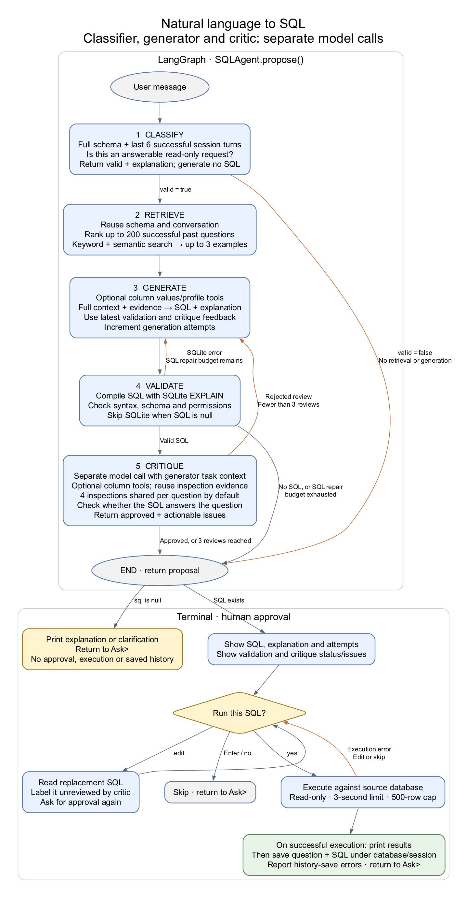
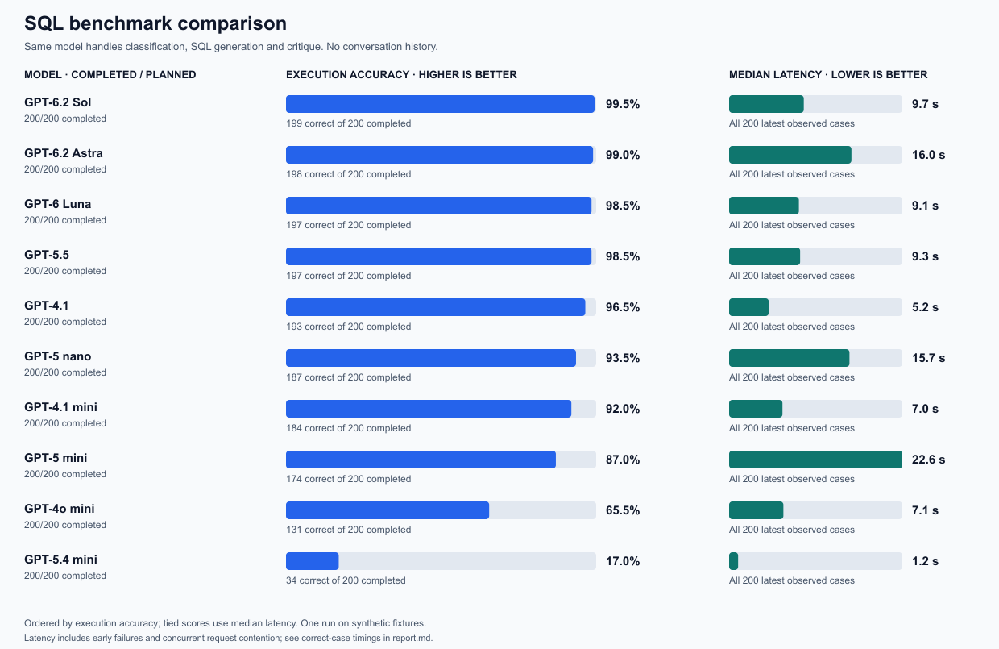

# Natural language to SQL

A small Python terminal app built with **LangGraph**. Ask a question, review or edit the generated SQL, and approve it to print results. It sends the full schema with every question, retrieves successful past queries using keyword and semantic search, remembers conversation context, repairs SQL validation errors, and critiques whether the SQL answers the question.

## Run

Requires Python 3.11+. The benchmark fixtures require SQLite 3.39+ for RIGHT and FULL OUTER JOIN.

```bash
git clone https://github.com/SrikarKorrapati/natural-language-to-sql.git
cd natural-language-to-sql
python3 -m venv .venv
source .venv/bin/activate
pip install -r requirements.txt
```

Set `OPENAI_API_KEY` in your environment or the project's `.env`, then point the app at an existing SQLite database:

```bash
python -m app.main --database /absolute/path/to/data.db --model gpt-4.1-mini
```

The default model is `OPENAI_MODEL`, or `gpt-4.1-mini`. Optional `OPENAI_BASE_URL` selects an OpenAI-compatible Chat Completions provider with JSON mode. Use `--session sales-analysis` to start or resume a named conversation.

The app checks that the source is an existing, readable SQLite database before starting. The source and conversation-history database must be different files.

## Hybrid retrieval

Hybrid retrieval searches previous successful questions. Keyword and semantic rankings have equal weight: each contributes `1 / (60 + rank)` through reciprocal rank fusion. Raw keyword and cosine-similarity scores are never compared directly.

See the [keyword ranking comparison](docs/keyword-ranking-comparison.md) for how the current scorer differs from TF-IDF and BM25.

Configure embeddings in your environment or `.env`:

| Setting | Default | Purpose |
| --- | --- | --- |
| `RETRIEVAL_MODE` | `hybrid` | Set to `keyword` to use keyword retrieval without embedding requests |
| `EMBEDDING_MODEL` | `text-embedding-3-small` | Model served by the embedding provider |
| `EMBEDDING_BASE_URL` | `OPENAI_BASE_URL`, otherwise `https://api.openai.com/v1` | OpenAI-compatible embedding endpoint |
| `EMBEDDING_API_KEY` | `OPENAI_API_KEY` | Credential for that endpoint |

A chat-compatible provider may not support embeddings. Set `EMBEDDING_BASE_URL`, `EMBEDDING_API_KEY`, and `EMBEDDING_MODEL` to a separate provider when needed. The endpoint must support the [embeddings API](https://developers.openai.com/api/reference/python/resources/embeddings/methods/create). An embedding failure prints a clear message and uses keyword-only retrieval for that question. Later searches attempt embeddings again. Each proposal reports the history retrieval mode actually used. With no successful history, it reports `none` and makes no embedding requests.

Every question receives the full current schema: all table and view DDL, including declared foreign keys. Historical retrieval searches the question text of the latest **200 successful queries from the same database**, selecting up to **three examples** before including their SQL in the model prompt.

Each hybrid history search requests fresh embeddings for its search text and all candidate questions, even when the text is unchanged. Vectors are discarded after ranking, and each agent gets its own retriever. No vector database is needed.

## Column inspection tools

The generator and critic can request two read-only tools before finalizing their JSON response:

| Tool | Information returned |
| --- | --- |
| `get_column_values(table, column, limit)` | Frequent distinct non-NULL values, with storage types and explicit truncation metadata |
| `get_column_profile(table, column, limit)` | Row/NULL/distinct counts, value frequencies, SQLite storage types, and numeric-only minimum, maximum and average |

For example, inspecting a status column can reveal that the stored label is `in_transit`, or that some rows have NULL status. The model can use this evidence to choose a filter or check an aggregation. Statistics describe observed data; they do not establish business rules.

Both tools accept exact table/view and column names, never arbitrary SQL. Each inspection uses one read-only snapshot with the database timeout (three seconds by default), returning at most 20 values. Text and BLOB values have explicit display caps. Generator, repairs and critic share **four tool requests per question** by default. Invalid requests consume the budget too. Set `SQL_MAX_TOOL_CALLS` from `0` to `20`; `0` disables tool calling for providers that only support JSON responses. With tools enabled, the chat provider must also support Chat Completions function calling.

Inspection runs before the final SQL approval prompt and sends bounded values/statistics to the chat provider. The final proposed SQL still requires approval. Evidence is reused within the current question and discarded afterward; it is not saved in conversation history. See [tool examples and limits](docs/column-inspection.md).

## Terminal workflow

Every question first goes to a **classifier agent**, using the full schema and the last six successful turns from the current session and database. It returns `valid` and an explanation. Answerable read-only requests proceed to historical retrieval and SQL generation. Greetings, unrelated or unclear messages, missing-data requests, and write requests return an explanation or clarification without embedding, generation, critique, approval, execution, or a history entry. There is no hardcoded greeting list. A malformed classifier decision stops processing and returns a brief error to `Ask>`.

Classifier, generator, and critic are separate model calls with separate instructions; they use the same configured model and provider. Classification adds one call per question, including greetings, and runs only once before any generation or repair loop. It uses conversation context to recognize follow-ups such as “only last month.” Generation can still return `sql: null` if a deeper ambiguity appears during generation or correction. Clarification replies ask for a complete restated question because only successfully executed turns are stored in conversation history.

The app prints SQL, a short explanation, and the attempt count, then asks:

```text
Run this SQL? [y/N/edit]:
```

Enter `y` to execute, press Enter to skip, or enter `edit` to replace the SQL. Finish multiline edits with a blank line and approve the replacement.

If SQL execution fails, the app shows the database error and lets you edit or skip the proposal. Provider and database errors return control to the conversation. Successful results remain visible if saving history fails; the app reports that the turn could not be remembered.

- `/new` starts a fresh conversation.
- `/schema` prints the schema.
- `/history` shows successful queries.
- `/exit` quits.

LangGraph runs **classify → retrieve → generate → validate → critique** for accepted inputs. The classifier checks whether the request is answerable; it does not prove that the generated SQL is correct. Validation uses SQLite `EXPLAIN`; invalid SQL returns to the generator for up to **five SQL repairs** per question. Set `SQL_MAX_REPAIRS` to change this repair budget.

After validation succeeds, a separate critique call uses the same model and provider to review meaning: intent, filters, joins, grouping, dates, ordering, and other correctness concerns. It receives the generator's full task context (schema, question, conversation, retrieved examples, and any correction feedback), plus the proposed SQL, explanation, and validation status, under its own review instructions. Greetings and clarification responses bypass critique.

Generator and critic share one limit policy: preserve requested top-N, pagination, or semantically necessary limits, and avoid arbitrary SQL limits on complete listings. The execution layer independently caps returned rows at 500 and marks truncated results.

The critique threshold is **three review rounds total**: the initial review and at most two reviews of revised SQL. Approval ends the loop early. Rejections send actionable issues back to the generator, and every revision goes through SQLite validation again. Critique revisions and SQL repairs have separate budgets; with the defaults, at most eight SQL proposals can be generated. The terminal shows the review status, round count, and any unresolved issues. If all three reviews reject the SQL, it is shown as **issues remain**, and you choose whether to edit, skip, or explicitly approve it. Critique is a model judgment, not proof that the answer is correct. Manual edits are labeled as unreviewed by the critic; database guardrails still apply when you approve execution.

See the [detailed SQL agent flow](docs/sql-agent-flow.md) for the graph, retry path, shared state, and post-graph approval step.



Memory includes the last six approved, successful turns in the conversation. Historical retrieval uses successful queries from the same database. Both persist in `data/history.db`. Source databases open read-only, with a three-second execution limit and a 500-row result cap.

## Benchmark models

[Browse all 200 input → SQL pairs](benchmarks/pairs.md): **20 schemas × 10 questions**, with 60 easy, 80 medium, and 60 hard cases. The dataset covers filters, joins, aggregation, subqueries, set operations, recursive queries, windows, dates, NULLs, ties, and duplicate rows.

```bash
python -m benchmarks.run --models gpt-4.1-mini gpt-4.1
```

The runner creates the 20 fixture databases, classifies each question, generates SQL for accepted requests with empty memory, and compares executed results with the reference SQL. It saves accuracy, SQL validity, latency, attempts, generated SQL, retrieval mode, classifier decisions and explanations, critique rounds, critique approval, critique issues, and errors to `benchmarks/results.json`. This runs the agent with the full schema, SQL repairs, and critique revisions. Each case starts with empty history, so history retrieval reports `none` and makes no embedding requests. Classification and critique use additional chat calls; latency includes these calls. A classifier rejection fails the case with zero generation attempts. The benchmark scores the final SQL even if the critic rejects it and records that rejection separately.

[Benchmark format and scoring](benchmarks/README.md). The [November 19, 2026 comparison](benchmarks/results-openai-10-2026-11-19/report.md) completed **2,000 evaluations across 10 GPT models**, using the full classifier, generator, validation/repair, and critique pipeline. The live run took 9.4 minutes and cost an estimated $16.83, including a separate diagnostic.

GPT-6.2 Sol scored 99.5%, GPT-6.2 Astra 99.0%, and GPT-6 Luna 98.5%. These are results on small synthetic fixtures, not a general model ranking. GPT-5.4 mini had 165 classifier-format failures before SQL generation. See the [interpretation and failure examples](benchmarks/results-openai-10-2026-11-19/analysis.md), [CSV leaderboard](benchmarks/results-openai-10-2026-11-19/leaderboard.csv), and [complete artifacts](benchmarks/results-openai-10-2026-11-19/README.md).



The published results are a historical snapshot of [commit abd74d8](https://github.com/SrikarKorrapati/natural-language-to-sql/commit/abd74d80045dbc3513eb99e2a7a71ec3128b059e). Subsequent reliability and limit-policy fixes have their own source fingerprint and require a new run to measure their accuracy.

## Code and tests

Core code lives in `app/main.py` for the terminal, `app/agent.py` for LangGraph, `app/retrieval.py` for keyword and semantic retrieval, and `app/db.py` for SQLite and memory. `app/inspection.py` implements bounded column queries, `app/tools.py` defines the tool allowlist, and `app/completion.py` decodes final answers and provider tool requests. Tests use controlled chat and embedding responses.

```bash
python -m pytest -q -p no:cacheprovider
```

## Privacy

In hybrid mode, after classification accepts the request and when successful history exists, the **embedding provider** receives question text only: the current question with the last two successful question texts for follow-up context, plus up to 200 candidate historical questions from the same database. These texts are sent on every search, including repeated questions. Schema and historical SQL are not embedded. Keyword mode and rejected requests make no embedding requests.

The **chat provider** receives the current question, the full current schema, and up to six successful conversation turns with their SQL for classification. Accepted requests send that context again for generation, with up to three retrieved question/SQL examples. The same task context is sent again for critique, together with the proposed SQL, explanation, validation status, and any correction feedback used for generation. These providers may be different when separate embedding settings are used.

Final query result rows stay local. When column inspection is enabled, bounded stored column values and aggregate statistics are sent to the chat provider during generation or critique, before final-query approval. Set `SQL_MAX_TOOL_CALLS=0` to disable this access. `.env` and source databases are excluded from Git. Conversation history in `data/history.db` can be committed to Git, including saved questions, SQL, and source database paths. Embedding vectors exist only while the current search is being ranked.
