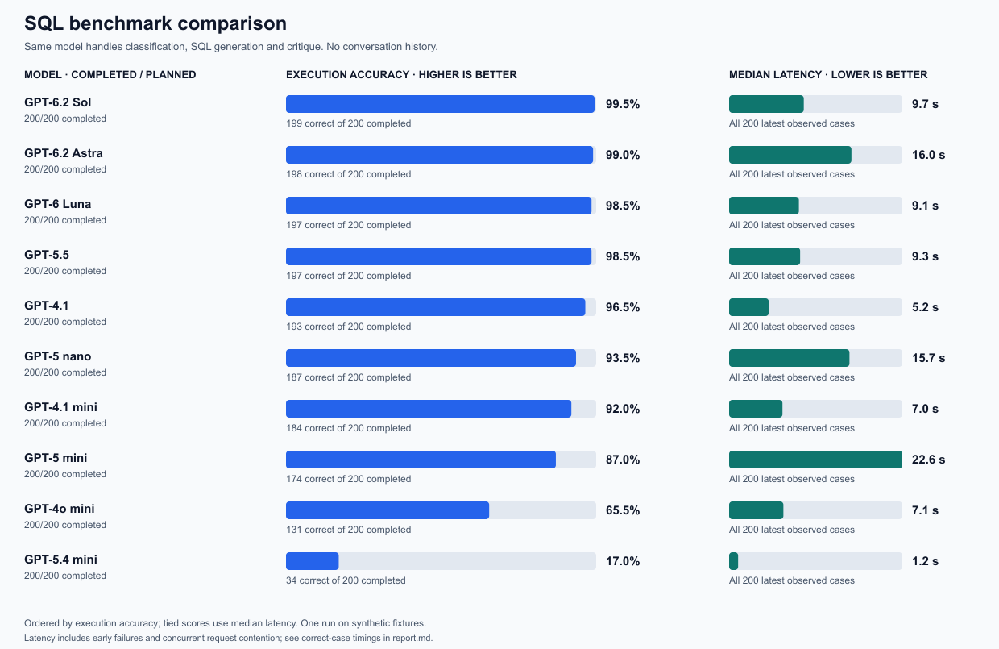

# Ten-model SQL benchmark — November 19, 2026

**2,000 completed evaluations: 200 questions per model, across 20 schemas.** Each model runs the classifier, SQL generator and critic with empty history. The live run took 9.4 minutes, made 8,323 benchmark API calls, and cost an estimated **$16.83**, including a separate diagnostic. Estimates use returned token usage and configured prices; they are not invoices.

Start with the [report](report.md) and [interpretation](analysis.md). These explain classifier-format failures, clarification requests, the generator/critic LIMIT disagreement, small-fixture limitations and changing concurrency.



## Artifacts

| File | Contents |
| --- | --- |
| [Report](report.md) | Scores, difficulty, latency, cost, critique and methodology |
| [Analysis](analysis.md) | Concrete failure examples and interpretation |
| [Leaderboard CSV](leaderboard.csv) | Overall metrics for all ten models |
| [Difficulty CSV](difficulty.csv) | Easy, medium and hard metrics |
| [Failures CSV](failures.csv) | All 306 unsuccessful final cases, with generated/reference SQL |
| [Leaderboard PNG](leaderboard.png) / [SVG](leaderboard.svg) | Overall comparison chart |
| [Difficulty PNG](accuracy-by-difficulty.png) / [SVG](accuracy-by-difficulty.svg) | Difficulty comparison chart |
| [cases.jsonl](cases.jsonl) | All 2,076 checkpoint records, including 76 interrupted attempts and usage |
| [results.json](results.json) | Final runner summary and completed case results |
| [manifest.json](manifest.json) | Model settings, code/data fingerprints and concurrency launch history |

The request settings and published token prices are in [models.openai.json](../models.openai.json). No API keys are included. The raw checkpoint and summary may be too large for GitHub's inline renderer; use the raw/download links or a local clone.

## Reproduce

Follow the [parallel benchmark instructions](../README.md#parallel-model-benchmark). Use a **new output directory** for another run to preserve this snapshot. The runner refuses to resume if its source, configuration or dataset fingerprint changes.

```bash
python -m benchmarks.parallel --config benchmarks/models.openai.json --output-dir benchmarks/results/new-openai-comparison --workers 20 --per-model-workers 2
python -m benchmarks.report --run-dir benchmarks/results/new-openai-comparison --cases benchmarks/cases.json
```

Concurrency is a case limit, not a requests-per-minute limit; configure it for your API limits. Token costs include all prior attempts. Each case's last completed outcome determines its score.
