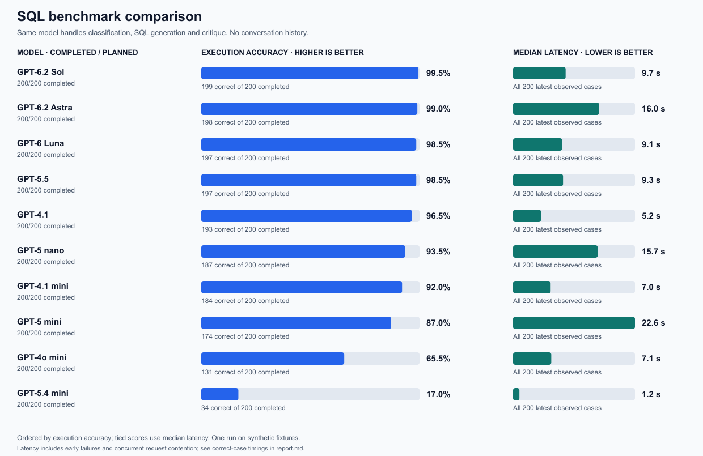
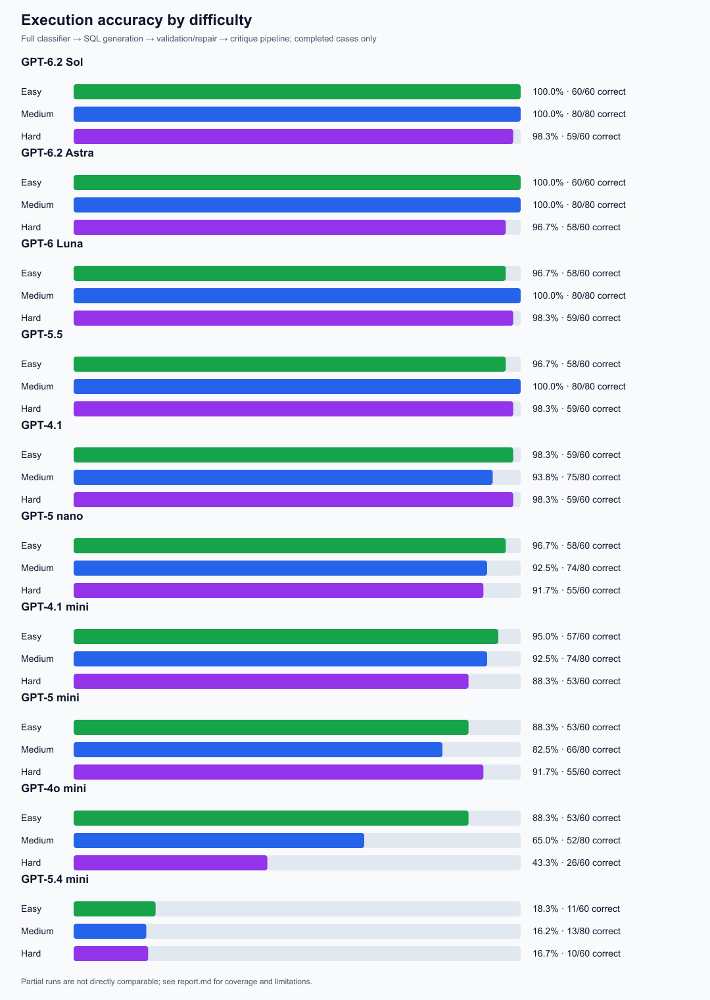

# Natural-language-to-SQL benchmark

Generated 2026-11-19T02:21:28+00:00 from [`cases.jsonl`](cases.jsonl).

Dataset: **200 questions across 20 SQLite schemas**. Difficulty distribution: 60 easy, 80 medium, 60 hard.

This evaluates the full application pipeline, using the same selected model for classification, SQL generation and critique. It is not a bare-model SQL-generation score. Each case receives its full schema and an empty history; reference SQL/results are used only by the evaluator. No embeddings or prior approved examples are used in this benchmark.

**Completed: 2,000 evaluations; 8,323 benchmark API calls; approximately $16.83 including the separate diagnostic.** Costs are estimates from returned usage, not an invoice. The live run took 9.4 minutes.

Read [interpretation and concrete failure examples](analysis.md). GPT-5.4 mini had 165 classifier-format failures before SQL generation. Sol and Astra's missed cases requested clarification. The fixtures contain at most 36 returned rows, so the results do not establish behavior on large outputs.

## Results

| Model | Completed / planned | Correct | Execution accuracy | Valid SQL | Classifier rejects |
| --- | --- | --- | --- | --- | --- |
| GPT-6.2 Sol | 200/200 | 199 | 99.5% | 99.5% | 0 |
| GPT-6.2 Astra | 200/200 | 198 | 99.0% | 99.0% | 0 |
| GPT-6 Luna | 200/200 | 197 | 98.5% | 99.5% | 0 |
| GPT-5.5 | 200/200 | 197 | 98.5% | 99.5% | 0 |
| GPT-4.1 | 200/200 | 193 | 96.5% | 100.0% | 0 |
| GPT-5 nano | 200/200 | 187 | 93.5% | 99.5% | 0 |
| GPT-4.1 mini | 200/200 | 184 | 92.0% | 98.0% | 0 |
| GPT-5 mini | 200/200 | 174 | 87.0% | 89.5% | 0 |
| GPT-4o mini | 200/200 | 131 | 65.5% | 84.5% | 15 |
| GPT-5.4 mini | 200/200 | 34 | 17.0% | 17.5% | 0 |

Execution accuracy compares generated result values to the reference on the fixture, preserving column order and duplicates. Aliases may differ. Row order is checked where the case requires it; numeric values use absolute tolerance 1e-6. Truncated results and completed errors fail. Valid SQL is the runner's SQLite validation flag; it does not establish that the query answers the question. All dataset inputs are intended to be valid database questions, so recorded classifier rejections fail the case.

## Difficulty

| Model | Difficulty | Correct / completed | Expected | Accuracy |
| --- | --- | --- | --- | --- |
| GPT-4o mini | easy | 53/60 | 60 | 88.3% |
| GPT-4o mini | medium | 52/80 | 80 | 65.0% |
| GPT-4o mini | hard | 26/60 | 60 | 43.3% |
| GPT-4.1 mini | easy | 57/60 | 60 | 95.0% |
| GPT-4.1 mini | medium | 74/80 | 80 | 92.5% |
| GPT-4.1 mini | hard | 53/60 | 60 | 88.3% |
| GPT-5 nano | easy | 58/60 | 60 | 96.7% |
| GPT-5 nano | medium | 74/80 | 80 | 92.5% |
| GPT-5 nano | hard | 55/60 | 60 | 91.7% |
| GPT-5 mini | easy | 53/60 | 60 | 88.3% |
| GPT-5 mini | medium | 66/80 | 80 | 82.5% |
| GPT-5 mini | hard | 55/60 | 60 | 91.7% |
| GPT-4.1 | easy | 59/60 | 60 | 98.3% |
| GPT-4.1 | medium | 75/80 | 80 | 93.8% |
| GPT-4.1 | hard | 59/60 | 60 | 98.3% |
| GPT-5.4 mini | easy | 11/60 | 60 | 18.3% |
| GPT-5.4 mini | medium | 13/80 | 80 | 16.2% |
| GPT-5.4 mini | hard | 10/60 | 60 | 16.7% |
| GPT-5.5 | easy | 58/60 | 60 | 96.7% |
| GPT-5.5 | medium | 80/80 | 80 | 100.0% |
| GPT-5.5 | hard | 59/60 | 60 | 98.3% |
| GPT-6 Luna | easy | 58/60 | 60 | 96.7% |
| GPT-6 Luna | medium | 80/80 | 80 | 100.0% |
| GPT-6 Luna | hard | 59/60 | 60 | 98.3% |
| GPT-6.2 Sol | easy | 60/60 | 60 | 100.0% |
| GPT-6.2 Sol | medium | 80/80 | 80 | 100.0% |
| GPT-6.2 Sol | hard | 59/60 | 60 | 98.3% |
| GPT-6.2 Astra | easy | 60/60 | 60 | 100.0% |
| GPT-6.2 Astra | medium | 80/80 | 80 | 100.0% |
| GPT-6.2 Astra | hard | 58/60 | 60 | 96.7% |

## Latency

| Model | All latest cases: median / p95 | Correct cases: median / p95 | Blocked / interrupted / unstarted |
| --- | --- | --- | --- |
| GPT-6.2 Sol | 9.7 / 17.7 s | 9.9 / 17.8 s | 0 / 0 / 0 |
| GPT-6.2 Astra | 16.0 / 27.4 s | 16.1 / 27.4 s | 0 / 0 / 0 |
| GPT-6 Luna | 9.1 / 19.2 s | 9.0 / 19.4 s | 0 / 0 / 0 |
| GPT-5.5 | 9.3 / 19.0 s | 9.2 / 19.0 s | 0 / 0 / 0 |
| GPT-4.1 | 5.2 / 8.9 s | 5.3 / 8.9 s | 0 / 0 / 0 |
| GPT-5 nano | 15.7 / 34.5 s | 15.5 / 30.6 s | 0 / 0 / 0 |
| GPT-4.1 mini | 7.0 / 16.6 s | 6.5 / 11.9 s | 0 / 0 / 0 |
| GPT-5 mini | 22.6 / 49.6 s | 23.5 / 49.5 s | 0 / 0 / 0 |
| GPT-4o mini | 7.1 / 17.5 s | 7.1 / 15.9 s | 0 / 0 / 0 |
| GPT-5.4 mini | 1.2 / 5.5 s | 5.0 / 8.1 s | 0 / 0 / 0 |

All-latest latency uses the last recorded attempt for each observed case, including infrastructure-blocked and interrupted attempts. Correct-case latency includes only completed cases with matching results. This report recomputes percentiles from raw records; they can differ from the runner summary's nearest-observation percentiles. These are end-to-end per-case durations recorded by the runner, including model calls, validation, critique, repairs and execution; they exclude worker-queue waiting. Superseded attempts' durations are not added to a later case's latency. p95 uses linear interpolation. Parallel request contention affects latency; these are not isolated model-speed measurements.

## Calls, tokens and cost

| Model | HTTP attempts | Input / output tokens | Cached input / reasoning tokens | Estimated cost | Provider-reported cost |
| --- | --- | --- | --- | --- | --- |
| GPT-6.2 Sol | 931 | 496,764 / 74,726 | 0 / 8 | $1.7408 | Unavailable |
| GPT-6.2 Astra | 959 | 503,543 / 74,526 | 0 / 1,402 | $7.0094 | Unavailable |
| GPT-6 Luna | 862 | 455,535 / 114,665 | 0 / 47,241 | $0.1029 | Unavailable |
| GPT-5.5 | 731 | 379,145 / 84,996 | 0 / 22,895 | $4.4456 | Unavailable |
| GPT-4.1 | 809 | 465,449 / 87,964 | 0 / 0 | $1.6346 | Unavailable |
| GPT-5 nano | 911 | 544,963 / 485,284 | 0 / 365,632 | $0.2214 | Unavailable |
| GPT-4.1 mini | 850 | 504,559 / 96,687 | 0 / 0 | $0.3565 | Unavailable |
| GPT-5 mini | 1048 | 705,861 / 379,830 | 0 / 203,264 | $0.9361 | Unavailable |
| GPT-4o mini | 937 | 565,946 / 99,787 | 0 / 0 | $0.1448 | Unavailable |
| GPT-5.4 mini | 285 | 138,745 / 29,180 | 0 / 9,706 | $0.2354 | Unavailable |

Tokens and costs sum the actual usage objects from **all checkpoint records**, including superseded blocked attempts and retries. Missing values are left unavailable rather than treated as measured zero. Cached-input and reasoning tokens are subsets, not extra tokens to add to input/output totals. Estimated cost applies the configured model prices to actual recorded input/output usage, with cache pricing when configured; it is not an invoice. Provider-reported cost is shown only when returned. A partial cost total means at least one HTTP attempt lacks that cost field; a timed-out request may still have consumed unreported work. Unreported usage, taxes or other provider fees are not included.

| Model | Successful HTTP calls | Missing token usage | Calls with cost estimate | Calls with provider cost |
| --- | --- | --- | --- | --- |
| GPT-6.2 Sol | 931 | 0 | 931 | 0 |
| GPT-6.2 Astra | 959 | 0 | 959 | 0 |
| GPT-6 Luna | 862 | 0 | 862 | 0 |
| GPT-5.5 | 731 | 0 | 731 | 0 |
| GPT-4.1 | 809 | 0 | 809 | 0 |
| GPT-5 nano | 911 | 0 | 911 | 0 |
| GPT-4.1 mini | 850 | 0 | 850 | 0 |
| GPT-5 mini | 1048 | 0 | 1048 | 0 |
| GPT-4o mini | 937 | 0 | 937 | 0 |
| GPT-5.4 mini | 285 | 0 | 285 | 0 |

## Revisions and critique

| Model | Generation passes | SQL revisions | Cases revised | Critique rounds | Critic approved / rejected / unreviewed | Approved but incorrect |
| --- | --- | --- | --- | --- | --- | --- |
| GPT-6.2 Sol | 363 | 163 | 103 | 362 | 144 / 55 / 1 | 0 |
| GPT-6.2 Astra | 356 | 156 | 107 | 354 | 151 / 47 / 2 | 0 |
| GPT-6 Luna | 322 | 122 | 98 | 320 | 187 / 12 / 1 | 0 |
| GPT-5.5 | 261 | 61 | 61 | 260 | 199 / 0 / 1 | 2 |
| GPT-4.1 | 301 | 101 | 96 | 297 | 200 / 0 / 0 | 7 |
| GPT-5 nano | 343 | 143 | 122 | 328 | 190 / 9 / 1 | 8 |
| GPT-4.1 mini | 329 | 129 | 110 | 307 | 195 / 1 / 4 | 11 |
| GPT-5 mini | 417 | 217 | 174 | 391 | 158 / 21 / 21 | 3 |
| GPT-4o mini | 375 | 191 | 116 | 338 | 121 / 48 / 31 | 20 |
| GPT-5.4 mini | 43 | 8 | 8 | 42 | 35 / 0 / 165 | 1 |

These counts use the final completed record for each case. SQL revisions are max(generation attempts − 1, 0), covering both SQLite-error repairs and critic-requested rewrites; the available telemetry does not separate those causes. Critic approval and execution correctness are independent measurements. The final SQL is scored even when the critic rejects it. A model-response failure can leave proposal-level attempt/critique counters unset; recorded logical calls below still capture completed work before the failure.

| Model | Classifier logical calls | Generator logical calls | Critic logical calls | Superseded checkpoint records |
| --- | --- | --- | --- | --- |
| GPT-6.2 Sol | 204 | 367 | 364 | 4 |
| GPT-6.2 Astra | 216 | 383 | 376 | 16 |
| GPT-6 Luna | 206 | 333 | 329 | 6 |
| GPT-5.5 | 204 | 266 | 265 | 4 |
| GPT-4.1 | 205 | 308 | 301 | 5 |
| GPT-5 nano | 215 | 366 | 345 | 15 |
| GPT-4.1 mini | 205 | 337 | 313 | 5 |
| GPT-5 mini | 216 | 442 | 406 | 16 |
| GPT-4o mini | 205 | 391 | 346 | 5 |
| GPT-5.4 mini | 200 | 43 | 42 | 0 |

Logical-call totals above include all attempts in the checkpoint; HTTP attempts also include transport retries.

## Method and limits

- This is a single run on this project's synthetic development dataset, not Spider/BIRD or a representative production workload.
- One fixed data fixture per question can let a semantically wrong query happen to return the expected rows. A match is not proof of SQL equivalence on every database.
- Difficulty labels are local author judgments. The run does not measure follow-up conversation, hybrid retrieval quality, or safety on adversarial/unanswerable requests.
- Empty case histories prevent within-run examples from leaking between cases. This does not establish that a model never saw similar public material during training.
- Sampling and provider execution can vary. Small score differences need repeated runs or more fixtures before drawing a strong model-quality conclusion.
- Classifier, generator and critic share one model in each configuration; the score includes their combined decisions and the configured retry budget. The terminal human-review step is excluded.

## Model identity

| Label | Requested model ID | Observed response model IDs |
| --- | --- | --- |
| GPT-6.2 Sol | gpt-6.2-sol | gpt-6.2-sol |
| GPT-6.2 Astra | gpt-6.2-astra | gpt-6.2-astra |
| GPT-6 Luna | gpt-6-luna | gpt-6-luna |
| GPT-5.5 | gpt-5.5 | gpt-5.5-2026-04-23 |
| GPT-4.1 | gpt-4.1 | gpt-4.1-2025-04-14 |
| GPT-5 nano | gpt-5-nano | gpt-5-nano-2025-08-07 |
| GPT-4.1 mini | gpt-4.1-mini | gpt-4.1-mini-2025-04-14 |
| GPT-5 mini | gpt-5-mini | gpt-5-mini-2025-08-07 |
| GPT-4o mini | gpt-4o-mini | gpt-4o-mini-2024-07-18 |
| GPT-5.4 mini | gpt-5.4-mini | gpt-5.4-mini-2026-03-17 |

Configured budgets: 5 SQLite-error repairs and 3 critique rounds. Request settings are preserved in the run configuration.

Run fingerprint: `ceac1d293c5da8934218f41991f37ecabb41bcc38b091e3f2a1d251cdc0cac76`.

Artifacts: [leaderboard.csv](leaderboard.csv), [difficulty.csv](difficulty.csv), [failures.csv](failures.csv), [accuracy/latency comparison](leaderboard.png), [difficulty chart](accuracy-by-difficulty.png). Failures include blocked/interrupted records, separately labeled; reference SQL appears only in this post-run report.
