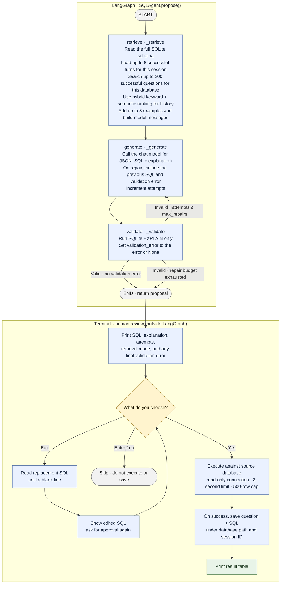

# SQL agent flow

The graph below shows how a question moves through LangGraph, where SQL repair loops, and what happens after the graph returns a proposal.

## What the shared state carries

`State` is a typed dictionary that LangGraph passes between nodes. Each node returns only the fields it adds or updates; LangGraph merges those updates into the shared state.

| Stage | Important state fields |
| --- | --- |
| Initial input | `question`, `session_id`, `model`, `attempts = 0` |
| `retrieve` | `messages`, `tables`, `examples`, `retrieval_mode` |
| `generate` | `sql`, `explanation`, incremented `attempts`, clears `validation_error` before checking again |
| `validate` | Sets `validation_error` to `None` on success or to SQLite's error text on failure |

The schema is sent in full to the chat model. Hybrid retrieval applies only to historical questions: keyword and semantic rankings are fused to choose up to three successful question/SQL examples. If no history is available, `retrieval_mode` is `none`; if embeddings fail, the retriever falls back to keyword-only search.

With `SQL_MAX_REPAIRS=5`, the graph can make six proposals total: the first proposal plus five repairs. If the final proposal still fails validation, the graph returns it with its validation error so the terminal can show it for review. The terminal approval step is outside LangGraph; only a successful execution is written to history.
