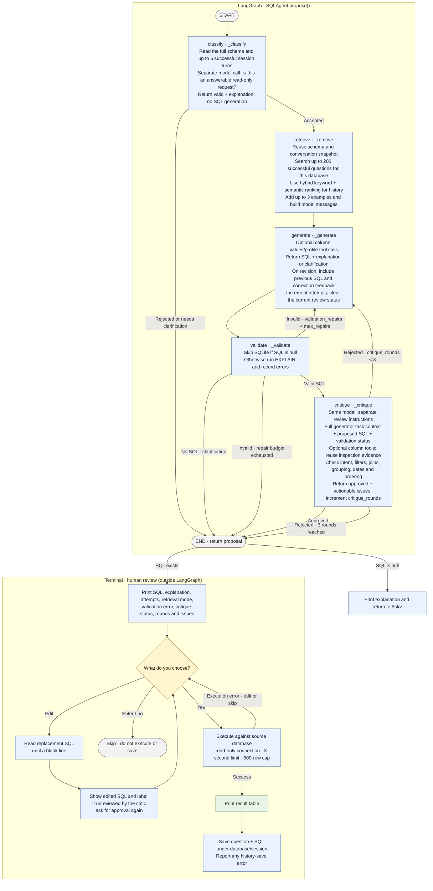

# SQL agent flow

The graph below shows input classification, SQL generation, SQLite validation, and a separate LLM critique before terminal approval. Every message enters the classifier, which receives the schema and recent conversation. Rejected requests return an explanation directly, skipping historical retrieval, embeddings, generation, validation, and critique. The generator can also return `sql: null` if generation or correction reveals a deeper ambiguity; validation skips SQLite and critique is skipped. In either case, the terminal prints the explanation and returns to `Ask>` without approval, execution, or saving history.

The PNG embedded in the README is generated from [sql-agent-flow.dot](sql-agent-flow.dot). Regenerate it from the project root with `dot -Tpng -Gdpi=120 docs/sql-agent-flow.dot -o docs/sql-agent-flow.png`.

## What the shared state carries

`State` is a typed dictionary that LangGraph passes between nodes. Each node returns only the fields it adds or updates; LangGraph merges those updates into the shared state.

| Stage | Important state fields |
| --- | --- |
| Initial input | `question`, `session_id`, `model`; counters `attempts`, `validation_repairs`, `critique_rounds` start at 0; review starts unset |
| `classify` | `schema`, `conversation`, `tables`, `input_valid`, `classification_explanation`; initializes the no-SQL response and empty retrieval metadata |
| `retrieve` | `messages`, `tables`, `examples`, `retrieval_mode` |
| `generate` | `sql` (or `None`), `explanation`, `generation_messages`, incremented `attempts`; increments `validation_repairs` only when correcting a SQLite error; clears validation and current review status |
| `validate` | Skips SQLite when `sql` is `None`; otherwise sets `validation_error` to `None` on success or to SQLite's error text on failure |
| `critique` | Increments `critique_rounds`; sets `critique_approved` and `critique_issues`; retains findings in `critique_feedback` for revisions and any subsequent SQLite repairs |
| Inspection inside `generate` / `critique` | Updates `tool_calls` (shared budget) and `inspection_results` (current-question evidence); neither is stored in conversation history |

The classifier makes one model call per question with its own instructions. It returns `valid` (a boolean) and `explanation` (a nonempty string); malformed decisions stop the request with a readable error. Accepted input routes to retrieval, while rejected input routes directly to `END` with `sql: null`, zero generation attempts, and `retrieval_mode: none`. This supports arbitrary messages without a greeting list. The classifier uses the same configured model/provider as generation and critique; `classify_complete` allows a separate adapter to be injected programmatically.

The schema is read once per question and sent in full to classification and generation, along with the same snapshot of six successful conversation turns. Classification happens only once, not on repairs. Hybrid retrieval applies only to historical questions after acceptance: BM25 and Qdrant cosine rankings are fused to choose up to three successful question/SQL examples. Qdrant stores historical embeddings locally; each search embeds the query and any candidate questions missing from the current collection. SQLite supplies the question/SQL pairs, and only current candidates can appear in results. If no history is available, `retrieval_mode` is `none` and neither embeddings nor Qdrant are used; if embeddings or vector storage fail, retrieval falls back to BM25. See [vector storage](vector-storage.md).

The critic receives the exact task messages used for the latest generation, including the question, full schema, history, examples, and any correction feedback. The generator's system instruction is replaced with the critic's own instructions. The proposal and validation status are supplied separately. It uses the same configured model and provider, but makes a separate call and evaluates correctness independently of the generator's explanation. Malformed reviews produce an error and return to the terminal prompt without offering execution.

The default threshold of **3 counts critique reviews**, including the first one. Three rejections permit only two critique-driven revisions; the third rejection ends the graph and remains visible as unresolved issues. `SQL_MAX_REPAIRS=5` allows five additional revisions for SQLite errors across the whole question. These budgets allow at most one classifier decision, eight SQL proposals, and three critique reviews. Inspection can add up to four model continuations across those stages by default, for at most 16 model calls before transport retries. Every SQL revision is validated again; a failed final revision has review status `None`, so an older review cannot appear to approve it.

Column inspection happens inside generation and critique, not in separate LangGraph nodes. Both roles can request `get_column_values` or `get_column_profile` and receive correlated tool results before producing their final JSON. `SQL_MAX_TOOL_CALLS` controls their shared budget (default 4; 0 disables). Invalid requests count, and inspection evidence is reused across revisions. Each inspection is a read-only database operation with bounded output and a shared operation deadline. See [column inspection](column-inspection.md) for outputs, privacy, and limits.

The terminal approval step is outside LangGraph. A rejected proposal can still be edited, skipped, or explicitly approved by the user after seeing the issues; only a successful approved execution is written to history. Manual edits are not automatically critiqued and are labeled accordingly. Final query result rows are never sent to the critic; bounded inspection values/statistics can be sent before the approval prompt.

Generator and critic share one LIMIT/OFFSET policy: preserve requested or semantically necessary limits, and avoid arbitrary SQL caps on complete listings. The execution layer reports truncation separately. Execution errors return to the edit/approval choice; provider and database errors return to `Ask>`. Results remain visible if a subsequent history save fails.
